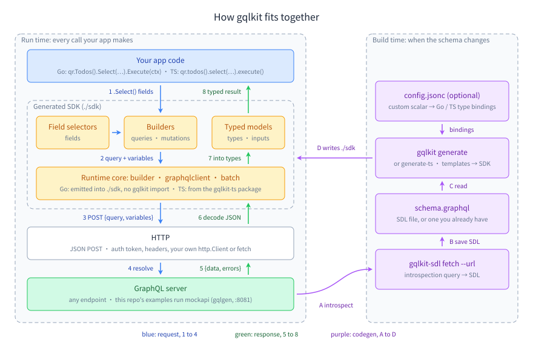

# GQLKit — GraphQL SDK generator CLI, schema fetcher, and Go + TypeScript runtimes

[](https://pkg.go.dev/github.com/ubgo/gqlkit/gqlkit) [](https://goreportcard.com/report/github.com/ubgo/gqlkit/gqlkit) [](https://github.com/ubgo/gqlkit/actions/workflows/test.yml) [](https://github.com/ubgo/gqlkit/actions/workflows/lint.yml)   [](https://github.com/ubgo/gqlkit/tags) [](./LICENSE) 

Generate fully typed GraphQL client SDKs for **Go** and **TypeScript** from any GraphQL schema. Built on a **builder pattern** with type-safe field selection — only the fields you select appear in the return type.

**Schema-first, not query-first:** generate builders once, then compose queries and mutations in code with dynamic, compile-time-checked field selection — one shared type per GraphQL type, no per-query codegen loop. Works with any GraphQL API, including large real-world schemas (Shopify Admin, Hasura, Apollo Federation).



**New here?** The [documentation index](./docs/README.md) has a [twelve-step learning path](./docs/README.md#learning-path) from a first query to a production setup, [decision guides](./docs/README.md#choosing-guides) for the main choices, and a [feature reference](./docs/reference/features.md) that links every feature to its guide and a runnable example.

## Install

Three things ship from this repo for users: two CLIs you run, and the `gqlkit-ts` runtime that a generated TypeScript SDK imports. A generated Go SDK needs no runtime package at all.

**The CLIs.** `gqlkit-sdl` pulls a schema off a live endpoint by introspection and writes it as SDL; `gqlkit` turns that SDL into a typed SDK, Go or TypeScript.

```bash
go install github.com/ubgo/gqlkit/gqlkit/cmd/gqlkit@latest
go install github.com/ubgo/gqlkit/gqlkit-sdl@latest
```

Without a Go toolchain, use the install scripts (macOS and Linux) or grab a [release binary](https://github.com/ubgo/gqlkit/releases) for any platform:

```bash
curl -sL https://raw.githubusercontent.com/ubgo/gqlkit/main/gqlkit/install.sh | sh
curl -sL https://raw.githubusercontent.com/ubgo/gqlkit/main/gqlkit-sdl/install.sh | sh
```

Every command and flag, with real output and exit codes: [`gqlkit`](./docs/cli-reference.md#gqlkit) · [`gqlkit-sdl`](./docs/cli-reference.md#gqlkit-sdl).

**The runtime.** A generated TypeScript SDK imports the builder, the HTTP client and batching from the `gqlkit-ts` npm package, so add it to the app that uses the SDK:

```bash
npm i gqlkit-ts
```

A generated Go SDK is self-contained: it writes its own `builder`, `graphqlclient` and `batch` packages next to the generated code, so there is nothing to `go get`. You only add the `github.com/ubgo/gqlkit/gqlkit` module if you [run the generator from your own Go program](./docs/cli/programmatic.md) instead of the CLI.

Then follow [Getting started — Go](./docs/getting-started-go.md) or [Getting started — TypeScript](./docs/getting-started-typescript.md).

## Contents

- [Install](#install)
- [Documentation](./docs/README.md): [learning path](./docs/README.md#learning-path), [choosing guides](./docs/README.md#choosing-guides), [feature reference](./docs/reference/features.md)
- [Quick Start — Go](#quick-start--go)
- [Quick Start — TypeScript](#quick-start--typescript)
- [Why GQLKit?](#why-gqlkit)
- [CLI reference](./docs/cli-reference.md)
- [Recipes](./docs/recipes.md)
- [Key Features](#key-features)
- [FAQ](#faq)
- [Versions and changelogs](#versions-and-changelogs)
- [Testing and coverage](#testing-and-coverage)
- [Contributing](#contributing)

## Quick Start — Go

**1. Fetch your schema** (skip if you already have a `.graphql` file):

```bash
gqlkit-sdl fetch --url https://your-api.example.com/graphql -o schema.graphql
```

**2. Generate the SDK** from your module root. `-m` is the import path of the output directory, which `go list -m` derives from your `go.mod`:

```bash
gqlkit generate --schema schema.graphql --output ./sdk --module "$(go list -m)/sdk"
```

**3. Use it.** Every import comes from the generated SDK; nothing is imported from gqlkit:

```go
import (
    "yourmodule/sdk/fields"
    "yourmodule/sdk/graphqlclient"
    "yourmodule/sdk/inputs"
    "yourmodule/sdk/queries"
)

client := graphqlclient.NewClient("https://your-api.example.com/graphql",
    graphqlclient.WithAuthToken("YOUR_TOKEN"),
)

qr := queries.NewQueryRoot(client)

boolPtr := func(b bool) *bool { return &b } // optional input fields are pointers

todos, err := qr.Todos().
    Filter(&inputs.TodoFilter{Done: boolPtr(false)}).
    Select(func(f *fields.TodoFields) {
        f.ID().Text().Done().User(func(u *fields.UserFields) {
            u.ID().Name()
        })
    }).
    Execute(ctx)
```

In Go, `todos` is a `[]types.Todo`: the fields you selected are filled in, and fields you did not select are present with zero values. (TypeScript narrows the result type to the selection instead; see [Go or TypeScript](./docs/choosing/go-vs-typescript.md).)

Full guide: [docs/getting-started-go.md](./docs/getting-started-go.md) · CLI walkthrough: [Generate a Go SDK](./docs/cli/generate-go.md)

## Quick Start — TypeScript

**1. Fetch your schema** (skip if you already have a `.graphql` file):

```bash
gqlkit-sdl fetch --url https://your-api.example.com/graphql -o schema.graphql
```

**2. Install the runtime:**

```bash
npm install gqlkit-ts
```

**3. Generate the SDK:**

```bash
gqlkit generate-ts --schema schema.graphql --output ./sdk --config config.jsonc
```

**4. Use it:**

```typescript
import { GraphQLClient } from "gqlkit-ts";
import { QueryRoot } from "./sdk/queries";

const client = new GraphQLClient("https://your-api.example.com/graphql", {
  authToken: "YOUR_TOKEN",
});

const qr = new QueryRoot(client);

const todos = await qr
  .todos()
  .filter({ done: false })
  .select((t) =>
    t.id().text().done().user((u) => u.id().name())
  )
  .execute();
```

Full guide: [docs/getting-started-typescript.md](./docs/getting-started-typescript.md) · CLI walkthrough: [Generate a TypeScript SDK](./docs/cli/generate-ts.md)

## Why GQLKit?

Existing GraphQL code generators like [genqlient](https://github.com/Khan/genqlient) (Go) and [GraphQL Code Generator](https://the-guild.dev/graphql/codegen) (TypeScript) take a **query-first** approach: you write every query as a static string upfront, then run codegen to produce types for each one. This creates real problems as your project grows.

### The duplicate types problem

In genqlient, every query generates its own unique types — even when they return the same GraphQL type. Two queries that both fetch a `User` produce two completely separate Go structs:

```graphql
# Two queries, same underlying User type
query GetUser($id: ID!)   { user(id: $id)   { id name email } }
query GetViewer            { viewer           { id name email } }
```

```go
// genqlient generates two unrelated structs — you can't pass one where the other is expected
type GetUserUser struct { Id string; Name string; Email string }
type GetViewerViewerUser struct { Id string; Name string; Email string }
```

With GQLKit, `User` is just `User`. One shared type across all queries:

```go
// GQLKit — one type, used everywhere
users, _ := qr.Users().Select(func(u *fields.UserFields) { u.ID().Name().Email() }).Execute(ctx)
user, _  := qr.User().ID("1").Select(func(u *fields.UserFields) { u.ID().Name().Email() }).Execute(ctx)
// Both return types.User
```

### Static queries vs. dynamic field selection

With genqlient and GraphQL Code Generator, field selection is locked at build time. Want the same query with different fields? Write another query, run codegen again, get another set of types.

GQLKit lets you choose fields at call time, checked against the schema by the compiler:

```go
// Lightweight list view — only fetch what you need
qr.Todos().Select(func(f *fields.TodoFields) { f.ID().Text() }).Execute(ctx)

// Detail view — same query, more fields, no codegen step
qr.Todos().Select(func(f *fields.TodoFields) {
    f.ID().Text().Done().Priority().Tags().User(func(u *fields.UserFields) {
        u.ID().Name().Email().Role()
    })
}).Execute(ctx)
```

```typescript
// TypeScript — same flexibility, compile-time narrowed return types
const light = await qr.todos().select((t) => t.id().text()).execute();
const full  = await qr.todos().select((t) => t.id().text().done().user((u) => u.id().name())).execute();
// light.done → compile error (not selected)
// full.done  → boolean (selected)
```

### Which approach fits the job

Compared by category rather than by product, since the trade-offs belong to the approach and not to any one tool. ✅ built in · ⚠️ possible with work · ❌ not available.

| The job | **Schema-first builder** (GQLKit) | Query-first codegen | Hand-written queries + manual types | Untyped/generic client |
|---|---|---|---|---|
| Add a query you did not anticipate | ✅ call the builder | ❌ write the operation, re-run codegen | ❌ write query + types by hand | ✅ but untyped |
| Vary which fields a call selects | ✅ per call site, type-checked | ❌ a new operation per variant | ⚠️ edit the string and the struct together | ✅ but untyped |
| Pass one entity type between layers | ✅ one type per GraphQL type | ❌ one type per operation path | ⚠️ whatever you declared | ❌ maps/`any` |
| Catch a removed schema field at compile time | ✅ | ✅ after regenerating | ❌ fails at run time | ❌ fails at run time |
| Target Go and TypeScript from one schema | ✅ same generator | ⚠️ a separate tool per language | ❌ written twice | ⚠️ |
| Start from a live endpoint with no SDL on disk | ✅ `gqlkit-sdl fetch` | ⚠️ depends on the tool | ⚠️ manual introspection | ✅ nothing to generate |
| Work with a schema of thousands of types | ✅ filter + prune before generating | ⚠️ per-operation output stays small | ✅ you write only what you need | ✅ |
| Avoid a codegen step in daily work | ✅ regenerate only when the schema changes | ❌ regenerate per query change | ✅ no codegen at all | ✅ |

The honest trade-off: query-first codegen knows each operation ahead of time, so it can validate the exact document you will send and produce a type shaped precisely to it. A builder validates the schema and narrows types at the call site instead. If your queries are a fixed, small set that rarely changes, that difference matters little; if you are composing queries across many call sites, the builder is what stops the type explosion.

### Comparison by tool

| | GQLKit | [genqlient](https://github.com/Khan/genqlient) (Go) | [GraphQL Code Generator](https://the-guild.dev/graphql/codegen) (TS) |
|---|---|---|---|
| **Approach** | Schema-first — generates builders from the schema | Query-first — generates types from predefined `.graphql` operations | Query-first — generates types from predefined operations |
| **Field selection** | Dynamic at call time, type-safe | Static, locked at codegen time | Static, locked at codegen time |
| **Type per GraphQL type** | One shared type (e.g., `User`) | One per query path (e.g., `GetUserUser`, `GetViewerViewerUser`) | One per operation (e.g., `GetUserQuery`, `GetViewerQuery`) |
| **Adding a new query** | Just call the builder — no codegen step | Write `.graphql` file, re-run codegen | Write query string, re-run codegen |
| **Changing field selection** | Change the `.Select()` call | Write a new query variant, re-run codegen | Write a new query variant, re-run codegen |
| **Config complexity** | One `config.jsonc` for scalar mappings | `genqlient.yaml` + `@genqlient` directives per field | 60+ plugins; typical project needs 2–5 configured together |
| **Output structure** | Organized packages (`queries/`, `fields/`, `types/`, etc.) | Single `generated.go` file | Varies by plugin; often one large file |
| **Schema introspection** | Built-in (`gqlkit-sdl fetch`) | Not supported — must provide local SDL files | Supported via config |
| **Runtime overhead** | Minimal — lightweight HTTP client | Minimal | Generated code includes duplicate query strings; needs Babel/SWC plugin to optimize |
| **Languages** | Go + TypeScript from same schema | Go only | TypeScript/JavaScript only |

For a decision table with the cases where a query-first tool is the better fit, see [gqlkit or a query-first generator](./docs/choosing/vs-query-first.md).

### TL;DR

- **genqlient / GraphQL Code Generator**: You write queries as static strings → codegen produces types for each one → types proliferate → changing fields means re-running codegen.
- **GQLKit**: You generate builders once from the schema → compose queries in code with dynamic field selection → one type per GraphQL type → no codegen loop for day-to-day work.

### AI-friendly by design

GQLKit's builder pattern works naturally with AI coding assistants (Copilot, Cursor, Claude). With query-first tools, the AI has to write raw GraphQL strings in a separate file, then you manually run codegen before the types exist — breaking the AI's flow. With GQLKit, the AI just writes code:

```
"fetch todos with user names" →

qr.Todos().Select(func(f *fields.TodoFields) {
    f.ID().Text().User(func(u *fields.UserFields) { u.ID().Name() })
}).Execute(ctx)
```

No `.graphql` files to create, no codegen to run, no types that don't exist yet. The builder API is fully discoverable from method signatures — the AI sees `.ID()`, `.Text()`, `.Done()`, `.User()` and chains them directly.

Deep dive: [docs/ai-friendly.md](./docs/ai-friendly.md)

## Key Features

- **Type-safe field selection** — every field and argument you select is checked against the schema at compile time, in both languages. In TypeScript the result type is also narrowed to the selection, so reading an unselected field is a compile error; in Go the result is the full struct and unselected fields hold zero values
- **Builder pattern** — fluent API for queries, mutations, arguments, and nested field selection
- **Go + TypeScript** — generate SDKs for both languages from the same schema
- **Single-request batching (Go + TypeScript)** — merge multiple query or mutation builders into one aliased GraphQL operation via `batch.RunQueries` / `batch.RunMutations` (Go) or `batch()` (TS) — one HTTP round trip for N operations, partial-success aware
- **Schema introspection** — fetch schemas from any GraphQL endpoint with `gqlkit-sdl`
- **Custom scalar mappings** — configure how GraphQL scalars map to language types via `config.jsonc`
- **Zero runtime overhead** — generated code with minimal dependencies; the Go SDK imports only the standard library plus any package a scalar binding names (such as `github.com/google/uuid`)

Every feature, with its guide and a runnable example: [feature reference](./docs/reference/features.md).

## Versions and changelogs

Each artifact is versioned and released independently, so each keeps its own changelog:

- `gqlkit` — [CHANGELOG](./gqlkit/CHANGELOG.md)
- `gqlkit-sdl` — [CHANGELOG](./gqlkit-sdl/CHANGELOG.md)
- [`gqlkit-ts`](https://www.npmjs.com/package/gqlkit-ts) — [CHANGELOG](./gqlkit-ts/CHANGELOG.md)

The [GitHub release pages](https://github.com/ubgo/gqlkit/releases) mirror the same entries. See [what ships here](#install) for what each one is.

## FAQ

**What is gqlkit?**
A code generator that turns a GraphQL schema (SDL) into a fully typed client SDK for Go and TypeScript. Instead of writing queries as static strings, you compose them in code with a fluent builder and pick fields at call time — the return type narrows to exactly the fields you selected.

**How is gqlkit different from genqlient or GraphQL Code Generator?**
Those tools are query-first: you write every operation as a `.graphql` string, run codegen, and get a separate type per operation — so two queries that both return a `User` produce two unrelated structs, and changing fields means editing the query and re-running codegen. gqlkit is schema-first: it generates builders once, `User` is always `User`, and you change field selection by changing the `.Select(...)` call. See [Why GQLKit?](#why-gqlkit) for the full comparison.

**Does gqlkit work with large or unconventional schemas (Shopify, Hasura, Apollo Federation)?**
Yes. The Go generator is verified to produce compiling SDKs for the Shopify Admin API (2,400+ types), Hasura schemas (lowercase scalar/enum names like `timestamptz`, `order_by`), and Apollo Federation types (`_Service`, `_Entity`) — including recursive object graphs and non-conventional query-root names like `QueryRoot`.

**Is the generated Go SDK self-contained?**
Yes. Each generated Go SDK ships its own `builder/`, `graphqlclient/`, and `batch/` packages — there is no runtime dependency on gqlkit itself, so `go get` is never needed to use one. Consumers only need the generated package plus their app code.

**Does it support mutations, batching, and custom scalars?**
Yes to all three. Mutations use the same builder pattern as queries; `batch.RunQueries` and `batch.RunMutations` (Go) / `batch()` (TS) merge multiple query or mutation builders into a single aliased request (one HTTP round trip, partial-success aware); and scalar-to-language-type mappings are configured in a `config.jsonc`. See [batching in Go](./docs/go/batching.md), [batching in TypeScript](./docs/typescript/batching.md) and [choosing a scalar binding](./docs/choosing/scalar-bindings.md).

**Which languages does it generate?**
Go and TypeScript, from the same schema. The Go and TypeScript SDKs expose the same builder API shape; what differs (result narrowing, unions, batch errors, runtime packaging) is listed in [Go or TypeScript](./docs/choosing/go-vs-typescript.md).

**How do I get the schema?**
Either point gqlkit at an existing `.graphql` SDL file, or fetch it from any live endpoint via introspection with `gqlkit-sdl fetch --url <endpoint>`.

**Is it production-ready?**
The generators have a two-layer test suite (unit tests on the type mapping plus end-to-end "generate and compile" guards) and a CI workflow that runs on manual dispatch only; the local `task check` is the gate. The artifacts version independently via SemVer; see each [changelog](#versions-and-changelogs).

## Testing and coverage

Coverage is measured per module, because each one is released and consumed separately. Run `task cover` to reproduce these numbers; they are read from the profile, not rounded by hand.

| Module | Statement coverage | Command |
|---|---|---|
| `gqlkit` | **94.9%** | `cd gqlkit && GOWORK=off go test -cover ./...` |
| `gqlkit-sdl` | **96.0%** | `cd gqlkit-sdl && GOWORK=off go test -cover ./...` |

`GOWORK=off` is deliberate: it resolves each module exactly the way CI and `go install` do, rather than through the workspace. A stale root `vendor/` directory (untracked, gitignored) will otherwise force `-mod=vendor` and fail the run with a missing test dependency.

Four functions report 0% and stay that way for reasons that no additional test can change:

- **`gqlkit/cmd/gqlkit/root.go:main`** and **`gqlkit-sdl/main.go:main`** — process entry points. They call `os.Exit`, so executing one ends the test binary. Everything they dispatch to is covered by each command's own tests.
- **`builder.QueryMarker.IsQueryOp`** and **`builder.MutationMarker.IsMutationOp`** — empty marker methods (`func (QueryMarker) IsQueryOp() {}`). They contain zero statements, and statement coverage counts statements, so the figure cannot rise above 0% even though `pkg/builder`'s tests call them on every run.

The markers are still pinned: `pkg/builder/marker_test.go` asserts, at compile time, that each type satisfies the interface `pkg/batch` requires, and that the two markers remain distinct types. That check matters because the interface is satisfied in *generated* SDKs — renaming a marker would leave this module green while every generated batch call site stopped compiling.

## Contributing

See [CONTRIBUTING.md](./CONTRIBUTING.md) for development setup, architecture, and how to run the examples.
